<div align="center">

# CourseTrace

**面向大学课程学习的 AI 视频学习平台**

让课程视频成为可检索的学习资料，让每次回答都能回到原始讲解。

<p>
  
  
  
  
  
  
  
</p>

[功能概览](#功能概览) · [项目预览](#项目预览) · [核心设计](#核心设计) · [快速启动](#快速启动) · [架构说明](docs/architecture.md) · [测试说明](docs/testing.md)

</div>

CourseTrace 将课程视频分片上传与断点续传、异步转录、时间戳字幕、章节笔记、检索问答与单学习 Agent 串成完整流程。适合回顾大学课程中的概念、寻找讲解位置，以及结合上下文理解知识点。回答附带可点击来源，方便回看原视频核对。

## 功能概览

- **上传与播放**：课程管理、MP4 分片上传、暂停续传和鉴权播放。
- **字幕与笔记**：提取课程语音，生成带时间戳的字幕和章节笔记。
- **课程问答**：从当前视频检索原文，带来源回答，点击引用回看讲解。
- **深入学习**：单学习 Agent 按需搜索和补读，展示有预算约束的工具执行记录。
- **任务与额度**：Kafka + Outbox 推进后台阶段，检查点支持恢复，Redis 双桶限制新工作提交。

体验路径：**登录 → 创建课程 → 上传视频 → 生成字幕与笔记 → 建立索引 → 普通 / 深入问答 → 点击来源回看**。

## 项目预览

以下为实际运行页面。演示课程使用[自写讲解原文](docs/demo/lesson-source.txt)和 Windows 合成语音，内容包含二分查找、栈与队列、循环队列；视频画面为纯色底，字幕、笔记、问答和工具记录来自已完成的真实处理链路。

### 1. 管理课程与上传视频

通过课程名称搜索学习资料，在课程内添加视频并查看资源检查结果。默认按 8 MiB 分片、最多两个并发传输；暂停、刷新或服务重启后，重新选择原文件可继续。上传会话与已确认分片存入 MySQL，临时对象保存在私有 MinIO；合并后校验 SHA-256 与媒体格式，再保存正式视频。默认总上限仍为 500 MB。

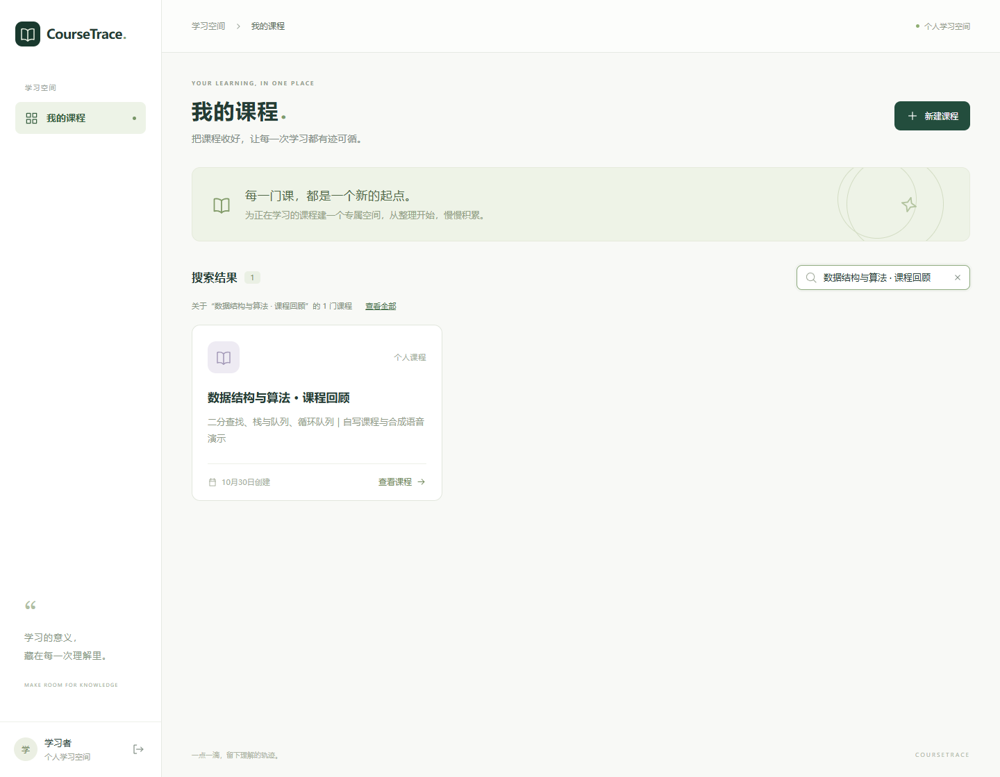

<details>
<summary>查看登录页、上传与资源检查</summary>

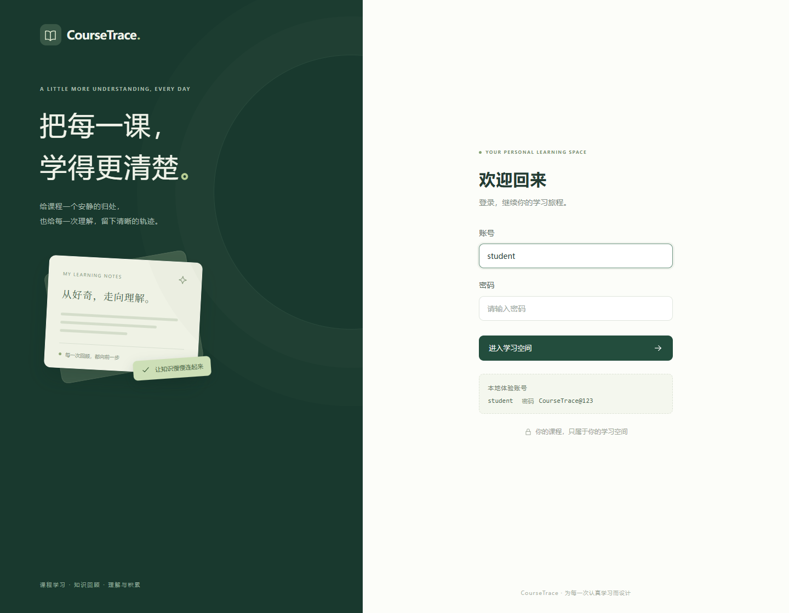

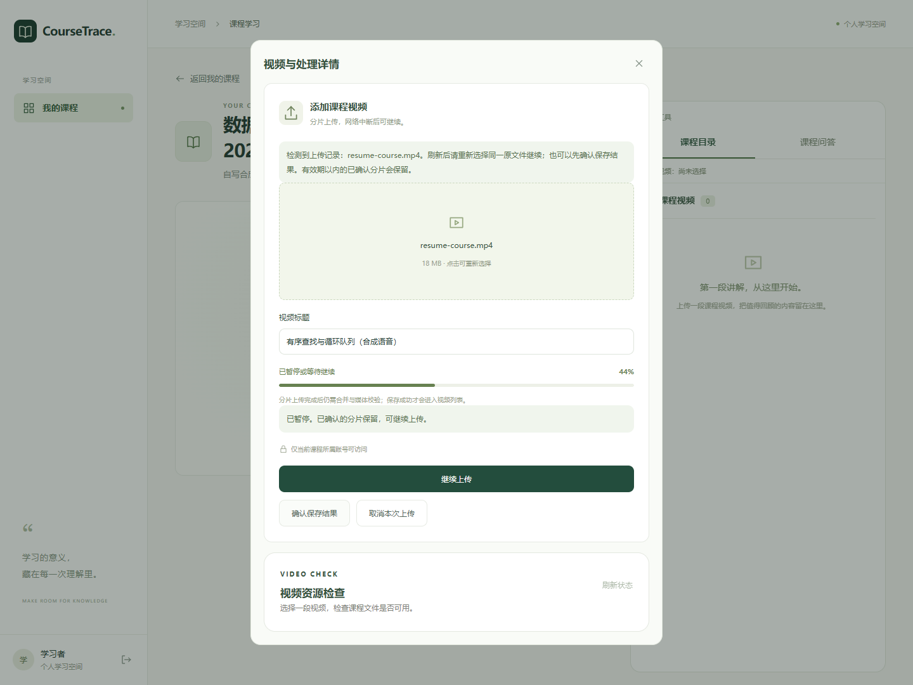

</details>

### 2. 回看视频、字幕与笔记

处理状态按阶段展示；字幕和笔记来源均可定位视频时间点。

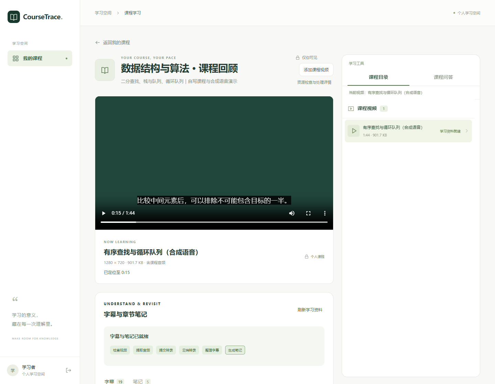

<details>
<summary>查看自动生成的章节笔记</summary>

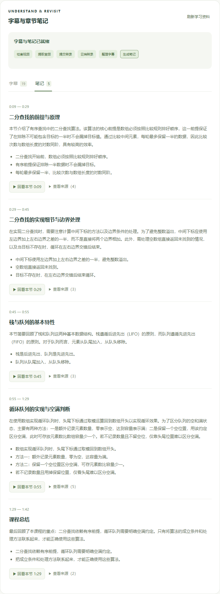

</details>

### 3. 基于课程提问，点击引用回看讲解

普通问答检索当前视频的字幕原文，回答中展示来源片段和时间戳。

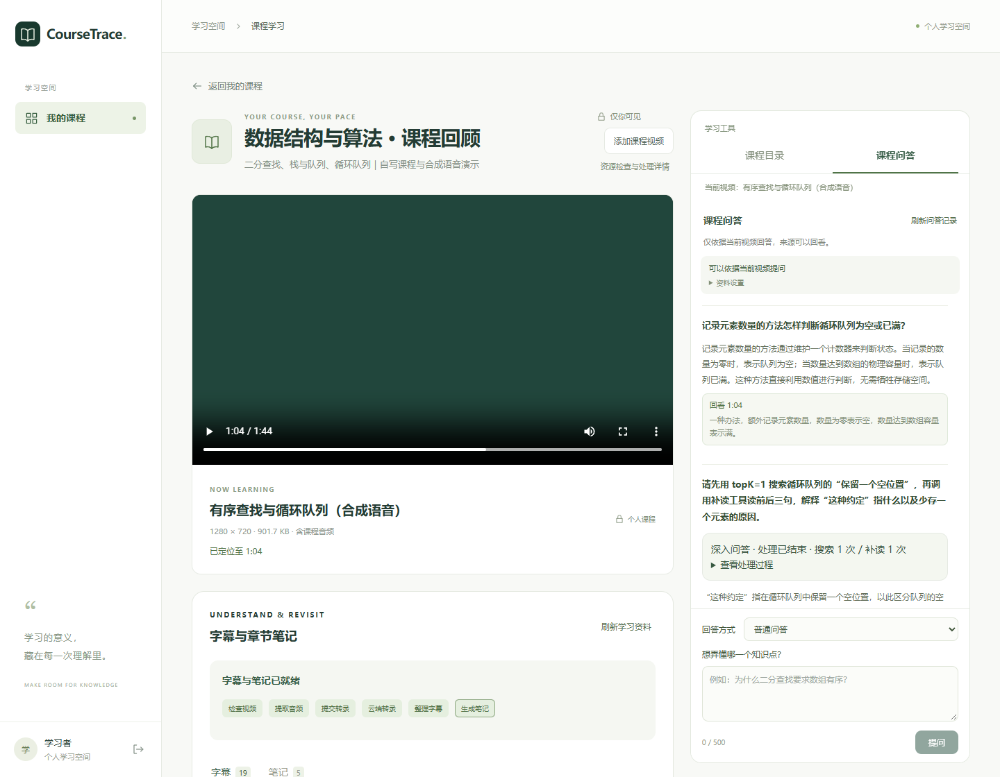

### 4. 用学习 Agent 搜索与补读

深入问答通过只读工具搜索课程、补读邻近字幕，并展示实际执行步骤、来源与执行预算。

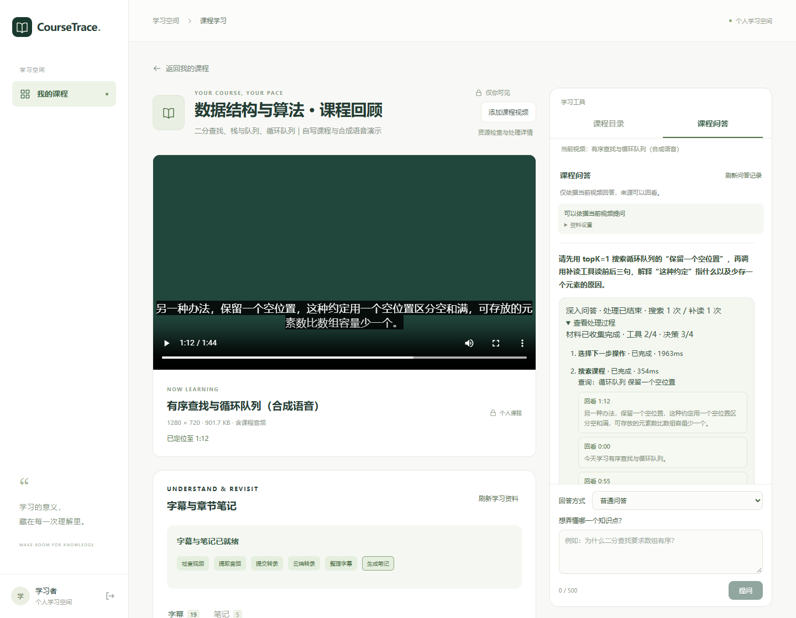

<details>
<summary>查看工具记录细节</summary>

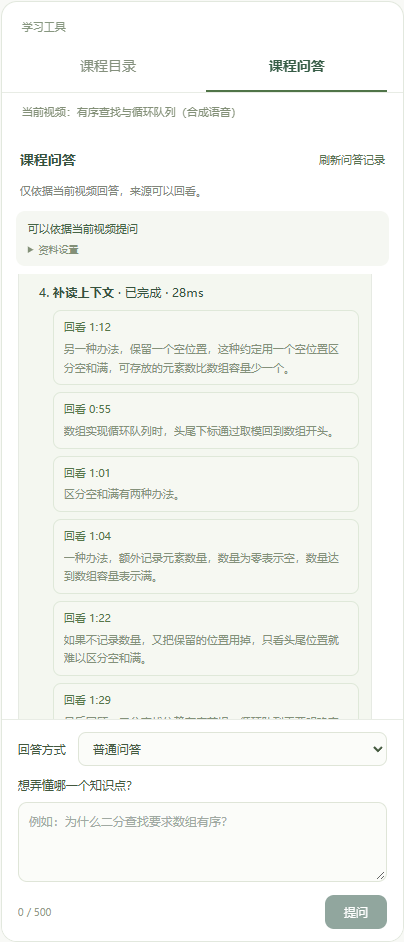

</details>

## 核心设计

| 问题 | 实现 | 行为与边界 |
|---|---|---|
| 大文件上传中断后从头重传 | 分片会话、SHA-256 校验、MinIO 服务端合并与幂等完成 | 只补传服务器未确认的分片；刷新后需重新选择原文件，会话默认保留 24 小时 |
| 新收费工作提交过于集中 | Redis Lua 原子检查用户与全局令牌桶，结合请求准入票据 | 429 返回 Retry-After；Redis 不可用时拒绝新收费工作，读取与播放不受此准入影响 |
| 转录、笔记和索引耗时较长 | Kafka + 任务表 + 阶段状态；Outbox 与任务在同一数据库事务提交 | 提交任务后查询阶段进度；发送确认后标记 Outbox，重复事件由消费者校验处理 |
| 外部接口失败或执行中断 | 短事务领取与提交；音频、ASR 任务和向量批次保存检查点；有限重试与人工恢复 | 复用已有阶段结果；远端结果不确定时保留状态，避免自动重复提交收费请求 |
| 回答难以核对来源 | 千问 Embedding + Qdrant 召回，再回查 MySQL 字幕和版本映射 | 模型选择来源，服务端校验原文偏移并生成时间戳；点击引用回到视频 |
| 单次检索可能缺少上下文 | LangChain4j 显式工具循环：`searchSegments`、`readSurroundingContext` | 后端固定用户与视频范围，限制决策、工具次数和总耗时；资料不足时返回对应状态 |
| 视频和学习资料属于不同用户 | Session + CSRF、资源归属检查、MinIO 私有对象与鉴权 Range 播放 | API、媒体读取、检索和引用均检查资源范围 |

Outbox 可能重复投递，消费者需要保持幂等；这不代表第三方模型请求严格“恰好一次”。Agent 展示的是工具执行记录，不包含模型内部思维过程。

<details>
<summary>查看额度不足时的草稿保留与等待提示</summary>

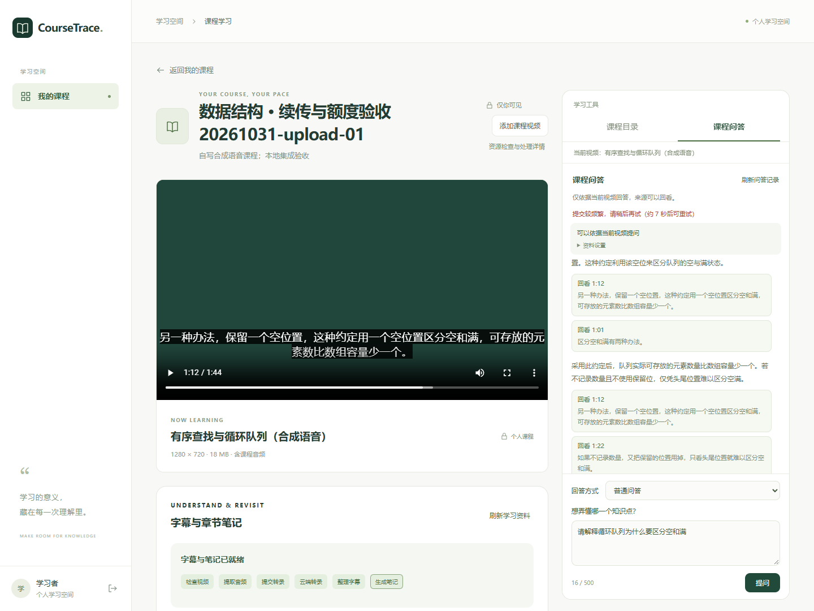

</details>

## 系统架构

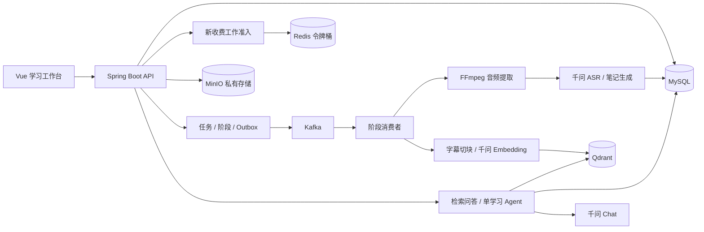

### 一次课程处理与问答

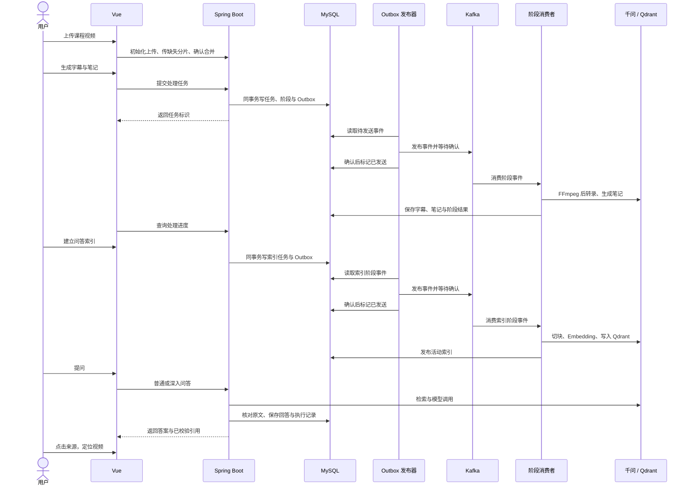

各模块职责、幂等约束和调用链见[架构说明](docs/architecture.md)。

## 技术栈

| 层次 | 技术与用途 |
|---|---|
| 后端 | Java 21 编译目标、Spring Boot 3.5、Spring Security、MyBatis-Plus、Flyway |
| 数据与异步 | MySQL 保存业务状态，Kafka + Outbox 驱动阶段任务，Redis 提供共享令牌桶，MinIO 保存媒体与处理产物 |
| 转录与生成 | FFmpeg、千问 ASR、千问 Chat、LangChain4j |
| 检索与 Agent | 千问 `text-embedding-v4`（1024 维）、Qdrant、显式工具调用循环 |
| 前端 | Vue 3、Vue Router、Vite |
| 运行与验证 | Docker Compose、PowerShell、JUnit、H2、Playwright |

具体版本和默认模型见 [infra/versions.json](infra/versions.json) 与 [.env.example](.env.example)。Redis 负责问答、转录笔记和索引新工作的用户/全局提交速率；问答历史、活动状态及每分钟硬限制仍在 MySQL，执行并发保护仍使用当前 JVM 的 Semaphore。令牌桶控制提交速率，不是精确费用计量或全局并发控制。

## 快速启动

主要支持 Windows 本地开发，已在 JDK 25（编译目标 21）、Maven 3.9、Node 24、pnpm 11.25、PowerShell 7 与 Docker Desktop 环境验证。首次准备在 PowerShell 7 执行，IDEA 共享启动器使用 Windows PowerShell。

1. 安装所需工具，打开 Docker Desktop，在 IDEA 中打开整个项目目录。
2. 在项目根目录执行首次准备：

   ```powershell
   .\scripts\prepare-local.ps1
   .\scripts\install-ffmpeg.ps1
   ```

3. 编辑生成的 `.env.local`，填写自己的 `DASHSCOPE_API_KEY`，按需调整模型、区域地址与媒体工具路径。该文件已被 Git 忽略。
4. IDEA 启用 **Shell scripts** 插件，运行共享配置 **CourseTrace - Start**；看到 Ready 后访问 [http://127.0.0.1:5173](http://127.0.0.1:5173)。
5. 使用 `student / CourseTrace@123` 登录，创建课程并上传视频，依次生成字幕/笔记、建立索引，再提问。

**停止服务：**运行 **CourseTrace - Stop**，保留数据库和媒体数据。

前后端依赖准备和后端构建由启动器执行。详细环境、手动启动和排障见[启动说明](docs/quickstart.md)。启动不会主动探测收费模型，已提交的后台任务仍会按队列继续执行。

## 验证

默认基础检查不调用收费模型：

```powershell
.\scripts\maven.ps1 test
.\scripts\pnpm.ps1 --dir client build
```

后端共 172 项测试。默认离线检查应为 164 通过、8 跳过：2 项收费模型冒烟、5 项真实 Redis、1 项真实 MinIO 均需显式开启。启用本地 Redis/MinIO 验证后，验收为 170 通过、2 项收费冒烟跳过。另已完成真实服务的上传、Kafka 处理、转录与索引、课程问答、Agent、引用跳转、依赖故障恢复和 IDEA 启动验收。

演示与验收使用自写合成语音课程。自动化覆盖范围、收费检查的开启条件和浏览器脚本前提见[测试说明](docs/testing.md)。

## 目录结构

```text
server/              后端业务、Flyway 数据库迁移与测试
client/              Vue 课程列表与学习工作台
infra/               Docker Compose、依赖版本与 MinIO 构建
scripts/             启动、媒体样片与功能验证脚本
.run/                IDEA 共享启动 / 停止配置
docs/
  quickstart.md      环境准备、启动与排障
  architecture.md    模块职责、调用链与设计约束
  testing.md         测试层次、运行方式与验证边界
  assets/            真实页面截图
  demo/              自写演示原文、题目与录屏讲解提纲
```

仓库保留运行和验证所需材料。个人学习笔记、开发计划、聊天记录、本地报告、真实凭据、依赖缓存、视频和录屏文件均不提交；演示截图不代表仓库自带已有业务数据。

## 当前范围

当前以中文口述课程、本人当前视频为范围，支持 MP4 分片上传与鉴权播放，内容理解以音频为主。跨视频检索、OCR、自测反馈、SSE、自动租约接管及跨实例并发控制暂未实现。现有小样本验证不代表真人长课准确率、生产高可用或高并发性能。
